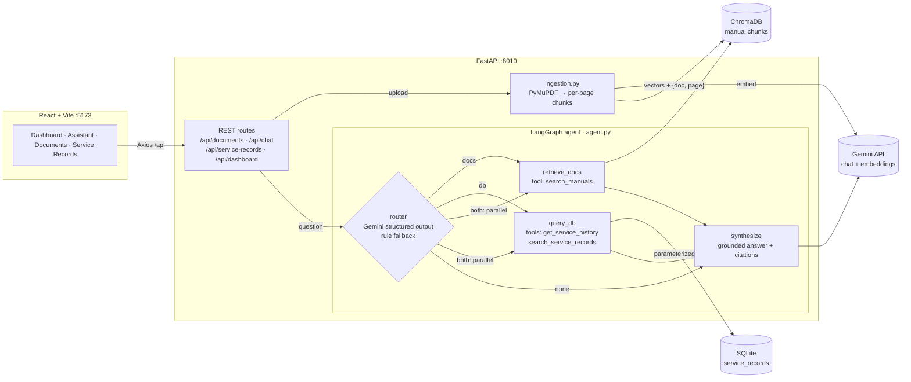

# Mini Enterprise Service Assistant

An AI assistant for manufacturing technicians. Upload equipment manuals (PDF), ask questions, and get answers
grounded in the manuals (with document + page citations) and in the machine service-history database.

**Stack:** React + Vite · FastAPI + Pydantic · LangGraph + LangChain · Gemini (chat + embeddings) · ChromaDB · SQLite + SQLAlchemy · PyMuPDF · Pytest

## Architecture



### How a question flows

1. **Router node:** Gemini returns a structured `RouteDecision` (`docs | db | both | none`, plus `equipment_id`,
   `issue_keyword`, `search_query`). The extracted values are validated with Pydantic before any tool sees them.
   Model names such as `XYZ-200` are not treated as machine IDs. If the LLM call fails, a keyword-rule router takes over.
2. **Conditional edges:** `both` fans out to `retrieve_docs` and `query_db` **in parallel**. Their outputs merge
   through LangGraph reducers.
3. **Tools:**
   - `search_manuals(query)`: embeds the query, searches ChromaDB, and keeps chunks within a cosine-distance threshold.
   - `get_service_history(equipment_id)`: fixed `SELECT … WHERE equipment_id = :id`.
   - `search_service_records(issue_keyword)`: fixed `ILIKE :pattern` over issue, diagnosis, resolution and error code.

   **The LLM never writes SQL.** It can only fill validated arguments into these pre-written queries.
4. **Synthesize node:** if no tool found evidence, the agent returns an "insufficient evidence" message **without
   calling the LLM**. Otherwise Gemini answers *only* from the numbered context, using `[D1]` labels for manual
   excerpts and service IDs for records. Citations are filtered to chunks that were actually retrieved, so the model
   cannot invent a source.

### How the relevance threshold was chosen
`RETRIEVAL_MAX_DISTANCE=0.35` was set from measured Gemini embedding distances on the sample manual.
Relevant questions (E104, overheating, hydraulic filter) scored 0.21–0.32. An off-topic technical question
("warranty for the robotic welding arm") scored 0.39–0.41. An unrelated question scored 0.47 or higher.
The LLM's own `sufficient_evidence` judgement then acts as a second gate.

### Why page-level chunking?
Each PDF page is split separately (1000 chars, 150 overlap), so every chunk belongs to exactly one page.
That is what makes the page numbers in citations accurate.

## Project structure

```
mini-service-assistant/
├── backend/
│   ├── app/
│   │   ├── main.py          FastAPI app, CORS, startup (creates + seeds DB)
│   │   ├── config.py        Settings from env / .env
│   │   ├── database.py      SQLAlchemy engine/session + 12 seed service records
│   │   ├── models.py        ORM tables: service_records, documents, query_logs
│   │   ├── schemas.py       Pydantic API schemas
│   │   ├── llm.py           Gemini chat + embedding factories
│   │   ├── ingestion.py     PDF validate → extract → chunk → embed → ChromaDB
│   │   ├── rag.py           Vector retrieval with relevance threshold
│   │   ├── tools.py         Validated tools (manual search + parameterized SQL)
│   │   ├── agent.py         LangGraph workflow (router → tools → synthesize)
│   │   ├── services.py      Business logic used by routes
│   │   └── routes/          documents.py · chat.py · records.py
│   ├── scripts/make_sample_manual.py
│   ├── tests/               offline tests + live Gemini tests
│   ├── requirements.txt
│   └── .env.example
├── frontend/
│   ├── src/components/      Sidebar, ChatWindow, Message, CitationCard, DocumentUpload
│   ├── src/pages/           Dashboard, Assistant, Documents, ServiceRecords
│   ├── src/services/api.js  Axios client
│   └── vite.config.js       proxies /api → backend
└── sample_data/
    ├── service_records.db   created + seeded on first backend start
    └── manuals/XYZ-200_Service_Manual.pdf
```

## Setup

Prerequisites: Python 3.10+ (developed on 3.12), Node 18+, and a Gemini API key from https://aistudio.google.com/apikey

### Backend
```bash
cd mini-service-assistant/backend
python3.12 -m venv .venv
source .venv/bin/activate
pip install -r requirements.txt
cp .env.example .env        # then edit .env and set GEMINI_API_KEY
uvicorn app.main:app --reload --port 8010
```
Interactive API docs: http://localhost:8010/docs

### Frontend
```bash
cd mini-service-assistant/frontend
npm install
npm run dev
```
Open http://localhost:5173. To point at a backend on another port, run `VITE_BACKEND_URL=http://localhost:8000 npm run dev`.

### Demo
1. **Documents** → upload `sample_data/manuals/XYZ-200_Service_Manual.pdf` (5 pages).
2. **AI Assistant** → click any example question.

## API

| Method | Endpoint | Description | Status codes |
|---|---|---|---|
| POST | `/api/documents/upload` | Upload + index a PDF (multipart `file`) | 201, 400 invalid, 409 duplicate, 502/503 indexing failed |
| GET | `/api/documents` | List documents with status | 200 |
| DELETE | `/api/documents/{id}` | Delete document + its vectors | 204, 404 |
| POST | `/api/chat` | `{"question": "..."}` → answer, citations, service_records, tools_used, route, sufficient_evidence | 200, 422, 502, 503 no API key |
| GET | `/api/service-records?equipment_id=M-10` | List/filter records | 200 |
| GET | `/api/service-records/{equipment_id}` | History for one machine | 200, 404 none, 422 bad ID |
| GET | `/api/dashboard/stats` | Counts, recent queries, recent incidents | 200 |

```bash
curl -F "file=@../sample_data/manuals/XYZ-200_Service_Manual.pdf" localhost:8010/api/documents/upload
curl -H 'content-type: application/json' -d '{"question":"Explain error code E104"}' localhost:8010/api/chat
```

## Testing

```bash
cd mini-service-assistant/backend
pytest -v                                  # offline: no API key needed
RUN_LIVE=1 pytest tests/test_live.py -v -s # the 5 scenarios against real Gemini
```

**Offline tests** swap Gemini for a deterministic bag-of-words embedding and a recording test double for the chat
model. Everything else runs for real: PyMuPDF, ChromaDB, SQLite, the LangGraph graph, the rule router, guardrails,
citation filtering and the HTTP layer. They cover:

| # | Scenario | Question | Verified |
|---|---|---|---|
| 1 | Answer from PDF | Explain error code E104. | route `docs`, `search_manuals`, top citation = manual **page 2** |
| 2 | Service history | Show service history for machine M-102. | route `db`, returns SR-1012, SR-1008, SR-1003, SR-1001 from SQLite, and those rows reach the LLM prompt |
| 3 | Docs + DB | Machine M-102 is overheating. What does the manual recommend, and has this happened before? | route `both`, all 3 tools, citation on **page 3**, records SR-1001 + SR-1003 |
| 4 | No supporting docs | What is the warranty period for the robotic welding arm? | no citations, `sufficient_evidence=false`, LLM **not** called |
| 5 | No matching record | Show service history for machine M-999. | empty records, `sufficient_evidence=false` |

The offline suite also covers upload validation (wrong type, fake/corrupt/empty PDF), duplicate detection,
retrying a failed upload, deletion, SQL-injection-style inputs being rejected, and every REST endpoint.

## Common errors

| Symptom | Cause / fix |
|---|---|
| `503 GEMINI_API_KEY is not set` | Create `backend/.env` from `.env.example` and restart uvicorn. |
| `address already in use` | Another app is using the port; use `--port 8011` and `VITE_BACKEND_URL=http://localhost:8011 npm run dev`. |
| Frontend shows "Cannot reach the backend" | Backend not running, or the Vite proxy is pointing at the wrong port. |
| Upload `400 No extractable text` | Scanned/image-only PDF; OCR is out of scope for this MVP. |
| Answers say "insufficient evidence" for relevant questions | Raise `RETRIEVAL_MAX_DISTANCE` in `.env` (cosine distance; lower = stricter). |
| `429` / quota errors from Gemini | Free-tier rate limit; wait a minute and retry. |
| Want a clean slate | Stop the backend, delete `backend/data/` and `sample_data/service_records.db`, then restart. |

## Design decisions and limits
- Ingestion runs synchronously in the request (fine for manuals of a few MB). A production version would use a
  background job queue and poll `status`.
- No authentication: this is a local demo.
- Retrieval uses one global relevance threshold. A production system might add a reranker or hybrid keyword + vector search.
